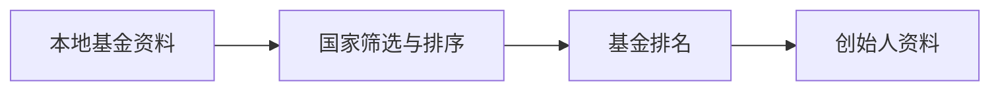

# Quantitative Hedge Fund Rankings

[English](README.md) · **简体中文**

从一张排名表，继续好奇基金背后的人，以及数字属于哪一年。

一个使用 HTML、CSS 和 JavaScript 的量化基金资料浏览网站，可按管理规模或年度收益排序，筛选中国、美国或全部基金，并查看创始人的公开背景。

## 可以浏览什么

仓库数据集收录 18 家美国基金和 15 家中国基金，资料标注的背景期间为 2024–2025 年。页面提供基金名称、创始人照片、教育经历和职业经历，以及当前筛选结果的数量、平均管理规模和平均收益。

这些汇总根据本地数据计算，资料需要按照来源日期阅读。管理规模、收益口径与基金分类应当重新核验，页面没有实时市场数据连接。

## 本地运行

```bash
git clone https://github.com/Bill306/quant-ranking.git
cd quant-ranking
python3 -m http.server 3000
```

打开 `http://localhost:3000`，选择国家与排序方式，再点击基金名称查看创始人资料。

`index.html` 负责页面，`styles.css` 负责样式，`script.js` 负责交互，`data.js` 保存资料。无需前端构建工具。

## 来源与贡献

英文 README 说明资料来自公开披露、财经媒体、行业出版物和公开讨论。欢迎提交带有日期与来源的数据修正。使用与再分发前请检查仓库的许可说明。


